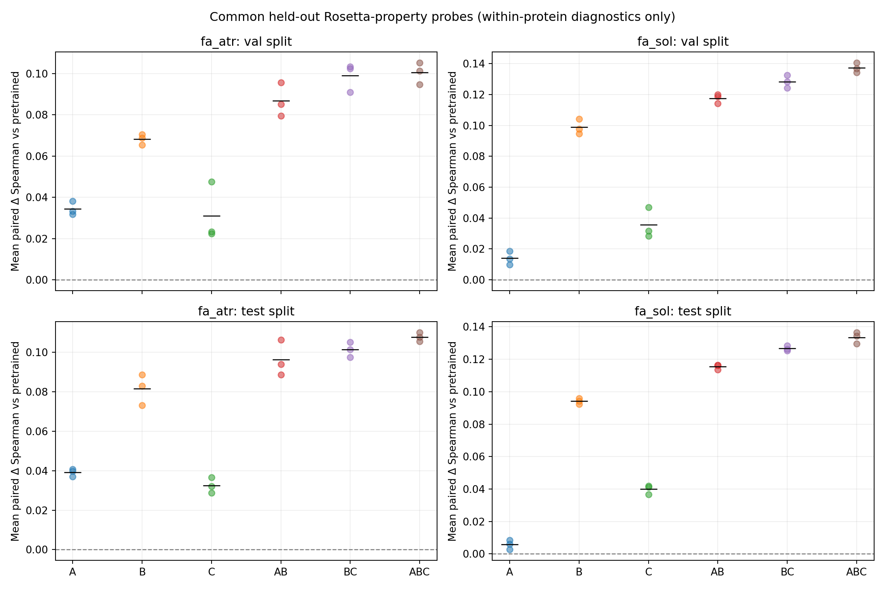
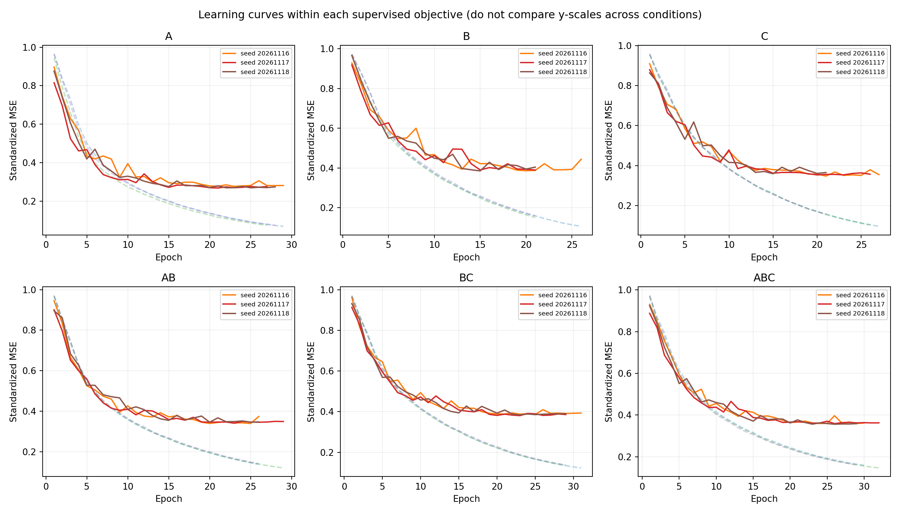
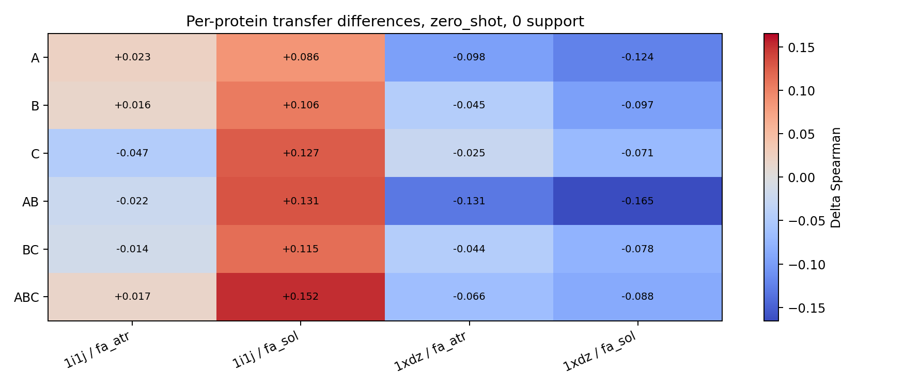
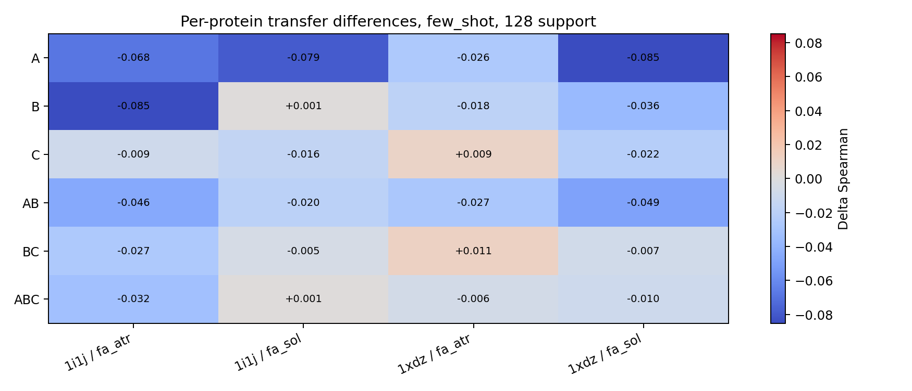
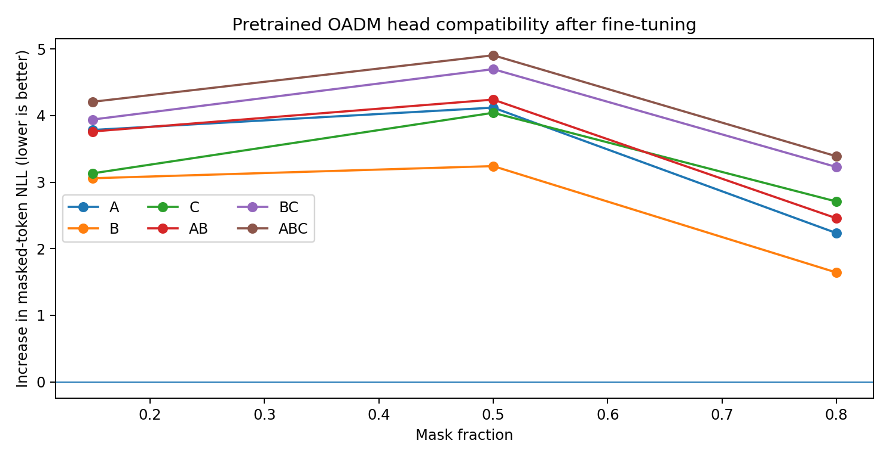
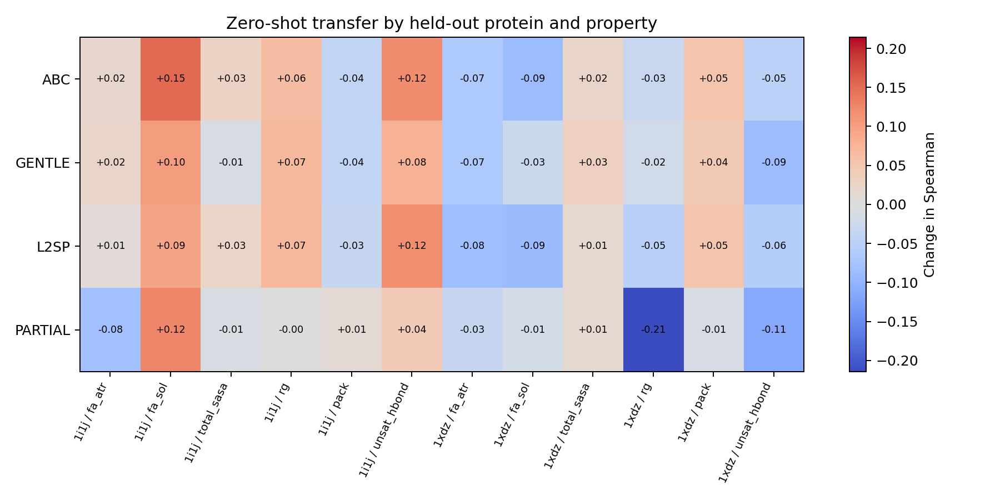
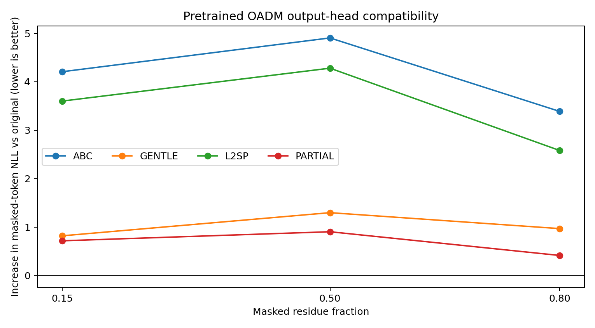
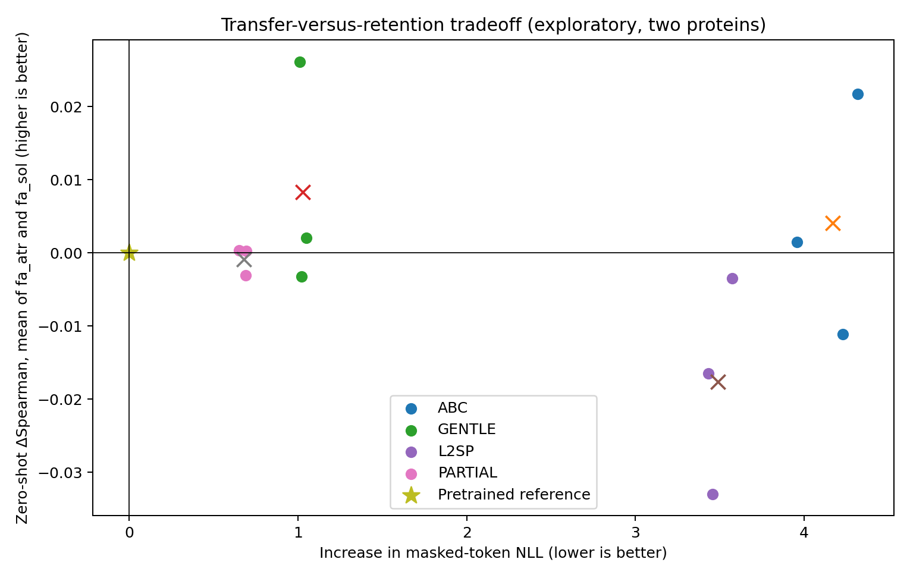
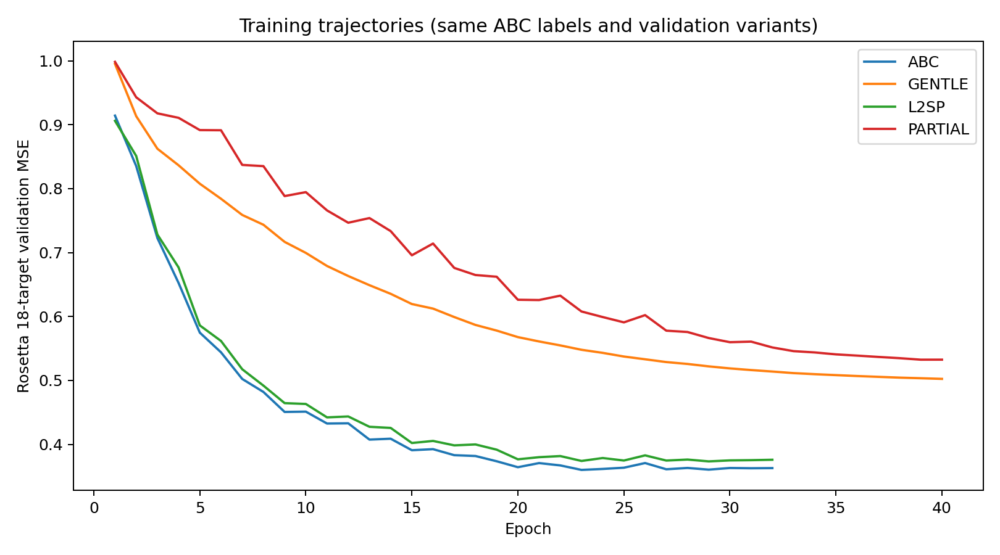

# Figures

These are the figures produced by the Engaging report scripts and copied here without redrawing them. Each has a corresponding CSV in the same stage's report directory. There are no manually invented error bars or reconstructed summary plots in this folder. The scripts that generated the images are committed alongside them.

## Before the transfer experiment

**Stage I: supervision ablation on the six source proteins**

**A note on these figures:** Stage I is about variants of the source proteins. The score differences are *not* evidence of transfer to proteins withheld from fine-tuning.

## Transfer to two other proteins

**Note:** the 'few-shot' support budgets in the original plots refer to 32, 128, or 512 training variants **plus a separate 500-label target development set for probe selection**. See [methods.md](methods.md).

## Changes to the fine-tuning strategy

For the full set of PNGs and raw values, see `results/evodiff/stage1/report/`, `results/evodiff/stage2/report/`, and `results/evodiff/checkin2/report/`.
